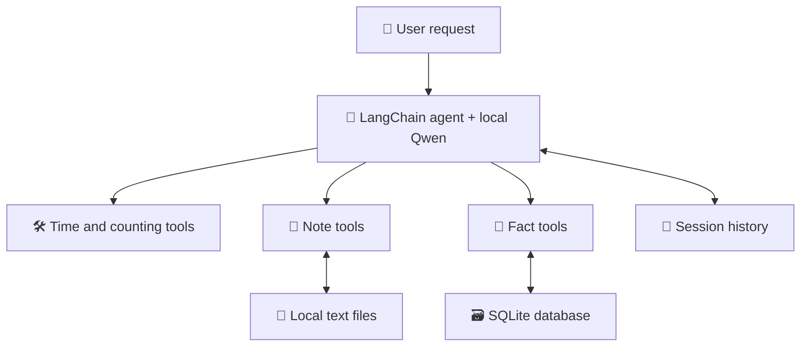

# 🤖 Local AI Agent with Tool Calling and Memory


A Python command-line agent that runs Qwen locally through Ollama,
selects tools, asks clarifying questions, and retrieves saved information
across restarts.

Built from Darsh Shah's freeCodeCamp tutorial and extended with note storage,
note discovery, character counting, and SQLite fact memory.

| 🟦 Learn AI | 🟩 Explore the implementation | 🟪 Inspect the evidence |
| --- | --- | --- |
| Tool calling and clarification | Eight Python tools | Visible tool-call traces |
| Conversation state | InMemorySaver | Follow-up questions |
| Persistent storage | Local notes and SQLite | Retrieval after restarting |

## 🧭 Architecture


## ✨ Features

| Capability | Implementation |
| --- | --- |
| Local inference | Ollama with qwen3.5:4b |
| Current date and time | current_time |
| Word counting | word_count |
| Character counting | character_count, including spaces and punctuation |
| Local notes | save_note and read_note |
| Note discovery | list_notes |
| Session memory | LangGraph InMemorySaver |
| Durable fact memory | remember_fact and recall_fact with SQLite |

## 🚀 Windows PowerShell setup

Install Python 3.14 and Ollama, then run:

```powershell
git clone https://github.com/anne500/local-ai-agent-tool-memory.git
Set-Location local-ai-agent-tool-memory
ollama pull qwen3.5:4b
py -3.14 -m venv .venv
.\.venv\Scripts\python.exe -m pip install -r requirements.txt
.\.venv\Scripts\python.exe .\agent.py
```

Ensure Ollama is running before launching the agent.
Type exit to end a session.

Development environment used Python 3.14.4 on Windows.
requirements.txt captures the installed Python package versions.

## 🧪 Verified demonstrations

### Tutorial baseline

The agent answered a general-knowledge question directly, called word_count
for a word-count request, called current_time for the local time, and recalled
the project name Cedar within the same session.

With tools, the system prompt, and the checkpointer disabled together, the
agent answered the simple word-count question directly but could not retrieve
the current time or recall Cedar from the preceding turn.

### Notes across restarts

```text
You: Save a note named cedar with the exact text: Cedar needs a CI smoke test.
[tool call] save_note({'name': 'cedar', 'text': 'Cedar needs a CI smoke test.'})
```

After exiting and restarting:

```text
You: Read my saved note named cedar.
[tool call] read_note({'name': 'cedar'})
```

The agent returned the saved text.

### Clarification and character counting

```text
You: What is the length of "Cedar CI!"?
```

The agent asked whether the user wanted words or characters.

```text
You: Characters, please.
[tool call] character_count({'text': 'Cedar CI!'})
```

The agent returned 9 characters.

### Facts across restarts

```text
You: Remember that my demo project is called Cedar.
[tool call] remember_fact({'key': 'demo_project_name', 'value': 'Cedar'})
```

After exiting and restarting:

```text
You: What is my demo project called?
[tool call] recall_fact({'key': 'demo_project_name'})
```

The agent answered Cedar.

## 🧠 Memory behavior

Session history lasts while the Python process runs.
Notes persist as text files in notes/.
Explicitly remembered facts persist in facts.sqlite3.
Saving a fact under an existing key updates its value.
Fact retrieval uses exact keys, with demo_project_name specified in the prompt
for the demonstrated project-name example.

The virtual environment, Python cache, notes, facts database, and recovery
backup are excluded from Git.

## 📋 Scope and limitations

These demonstrations are manual functional checks.
Tool selection and arguments depend on the local model.
Character counting uses Python len(), which counts Unicode code points.
The CLI currently uses a single conversation thread and a shared local fact store.

## 📚 Tutorial and attribution

The starting point is Darsh Shah's tutorial,
[How to Build Your Own Local AI Agent with Tool Calling and Memory](https://www.freecodecamp.org/news/how-to-build-your-own-local-ai-agent-with-tool-calling-and-memory/).

The tutorial baseline uses current_time, word_count, and session memory.
Project extensions add local note tools, character counting, clarification
instructions, and SQLite-backed fact memory.
