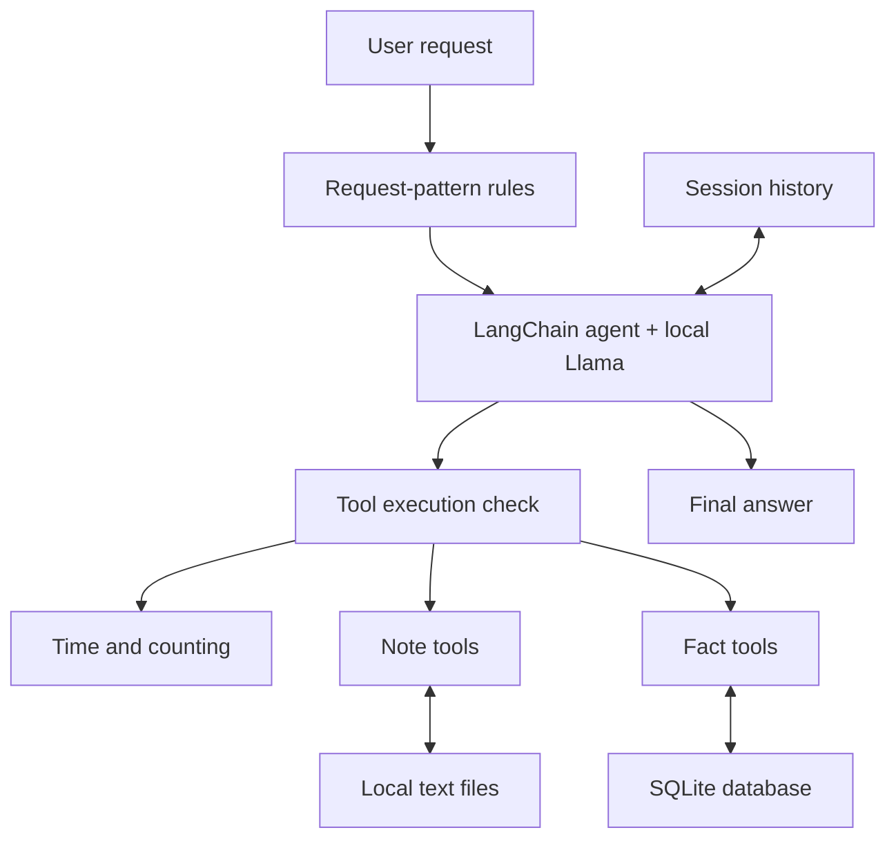

# 🤖 Local AI Agent with Tool Calling and Memory


A Python command-line assistant using local Ollama inference, eight tools,
conversation history, text-file notes, and SQLite fact memory.

Middleware selects available tools for each user turn and checks tool access
before execution. Ordinary conversation starts with no tools available.

Built from Darsh Shah's freeCodeCamp tutorial and extended with note storage,
note discovery, character counting, durable facts, and tool-access middleware.

| 🟦 Learn AI | 🟩 Explore the implementation | 🟪 Inspect the evidence |
| --- | --- | --- |
| Tool calling | Eight Python tools | Tool-call and tool-result traces |
| Conversation memory | LangGraph InMemorySaver | Recall within a session |
| Persistent memory | Text files and SQLite | Saved information across restarts |
| Tool access | Selection and execution middleware | Request-specific tool availability |

## 🧭 Architecture



## ✨ Features

| Capability | Implementation |
| --- | --- |
| Default local model | llama3.2:3b through ChatOllama |
| Model override | CHAT_MODEL environment variable |
| Local date and time | current_time |
| Whitespace-separated word count | word_count |
| Character count | character_count using Python len() |
| Save, read, and discover notes | save_note, read_note, list_notes |
| Conversation history | InMemorySaver, keyed by thread ID |
| Persistent facts | remember_fact and recall_fact |
| Tool access | select_turn_tools and enforce_turn_tools |
| CLI visibility | Tool calls, tool results, and final answers |

## 🚀 Windows PowerShell setup

Install Python 3.14, Git, and Ollama, then run:

```powershell
git clone https://github.com/anne500/local-ai-agent-tool-memory.git
Set-Location local-ai-agent-tool-memory

ollama pull llama3.2:3b
py -3.14 -m venv .venv
.\.venv\Scripts\python.exe -m pip install -r requirements.txt

$env:CHAT_MODEL = "llama3.2:3b"
.\.venv\Scripts\python.exe .\agent.py
```

Ensure Ollama is running before launching the agent.
Type `exit` to end a session.

The verified development environment used Windows, Python 3.14.4,
and Ollama 0.40.5. `requirements.txt` records installed package versions.
Installation in a fresh environment has not yet been verified.

## 💬 Supported requests

Routing uses explicit prefixes and regular expressions. It does not provide
general natural-language intent recognition.

| Operation | Example request |
| --- | --- |
| Word count | How many words are in "build release integration"? |
| Character count | How many characters are in "copper-91"? |
| Local time | What time is it? |
| Local date | What is today's date? |
| Save note | Save a note: name release_plan, text Run the CI smoke test. |
| Read note | Read note: release_plan |
| Discover notes | List saved notes |
| Save fact | Remember this fact: my demo project name is Local Agent Memory Lab. |
| Retrieve fact | Recall fact: my demo project name. |

Memory prefixes are case-insensitive. Counting and time requests must match
the patterns in `allowed_tools_for_turn()`.

For an ambiguous text-length question, the prompt instructs the assistant to
ask whether the user means words or characters. After clarification, use a
complete supported request, such as `How many characters are in "Cedar CI!"?`.
A reply such as `Characters, please.` does not enable a tool by itself.

## 🧪 Verified manual demonstrations

### Conversation history without tools

```text
You: My practice release label is copper-91.
Answer: You're using a practice release label for your project.
        What would you like to do with that label?

You: What practice release label did I just give you?
Answer: You mentioned that your practice release label is copper-91.
```

Neither turn produced a tool call.

### Character counting

```text
You: How many characters are in "copper-91"?
[tool call] character_count({'text': 'copper-91'})
[tool result] 9

Answer: There are 9 characters in the text "copper-91".
```

Word counting also returned 3 for `build release integration` in an
earlier Llama agent run, before the final routing revision.

### Explicit note saving and retrieval

```text
You: Save a note: name routing_check_01, text Tool access is controlled by middleware.
[tool call] save_note({'name': 'routing_check_01', 'text': 'Tool access is controlled by middleware.'})
[tool result] Saved note 'routing_check_01'.

You: Read note: routing_check_01
[tool call] read_note({'name': 'routing_check_01'})
[tool result] Tool access is controlled by middleware.
```

The operations succeeded. The model's final responses did not clearly
confirm the save or attribute the retrieved text to the note file.

### Facts across process restarts

The agent saved `Local Agent Memory Lab` under `demo_project_name`.
After exiting and restarting, `recall_fact` retrieved that value.

Following the middleware introduction, this request also retrieved it:

```text
You: Recall fact: my demo project name.
[tool call] recall_fact({'key': 'demo_project_name'})
[tool result] Local Agent Memory Lab
```

## 🧠 Memory and storage

| Storage | Lifetime | Behavior |
| --- | --- | --- |
| Conversation history | Current Python process | One CLI thread; lost on exit |
| notes/note-NAME.txt | Across restarts | Explicit note saves; existing notes are not overwritten |
| facts.sqlite3 | Across restarts | Facts saved by key; an existing key is updated |

Note names accept 1 to 40 ASCII letters, digits, hyphens, or underscores.
Filenames are normalized to lowercase.

Fact keys are stripped and lowercased. Retrieval uses exact keys.
The prompt specifies `demo_project_name` for the demo project name.

The virtual environment, Python cache, notes, SQLite database files, and
agent backup are excluded by `.gitignore`.

## 🔬 Model troubleshooting evidence

| Model | Observed behavior |
| --- | --- |
| functiongemma:270m | Repeated word_count calls and reached the generation limit |
| llama3.2:3b | One correctly formed word_count call and normal termination |

FunctionGemma's repetition persisted after refreshing the official model.
It also occurred with an explicitly formatted raw prompt and in a request
using `num_gpu: 0`. CPU placement was not independently confirmed.

The root cause remains unresolved. These observations do not establish a
general model ranking or isolate a specific Ollama defect.

Llama is the working default. Other installed models have not been
systematically evaluated against the final middleware implementation.

## 📋 Scope and limitations

- Evidence consists of manual functional checks, not a benchmark.
- Narrow request patterns restrict supported phrasing and combined requests.
- Middleware controls tool availability; model-selected arguments can still be wrong.
- The execution guard's rejection path has not yet been directly tested.
- Final responses can be vague or misinterpret tool results.
- Character counting measures Unicode code points, not visual grapheme clusters.
- The CLI uses one conversation thread and shared local storage.
- The CLI does not yet handle invocation failures or recursion-limit errors gracefully.
- Public multi-user hosting, authentication, and broader model evaluation are future work.

## 📚 Tutorial and attribution

Starting point: Darsh Shah's freeCodeCamp tutorial,
[How to Build Your Own Local AI Agent with Tool Calling and Memory](https://www.freecodecamp.org/news/how-to-build-your-own-local-ai-agent-with-tool-calling-and-memory/).

The tutorial baseline introduced time and word-count tools with session memory.
This project adds character counting, note storage and discovery, SQLite facts,
model selection through an environment variable, tool-result logging, and
request-specific tool access.
